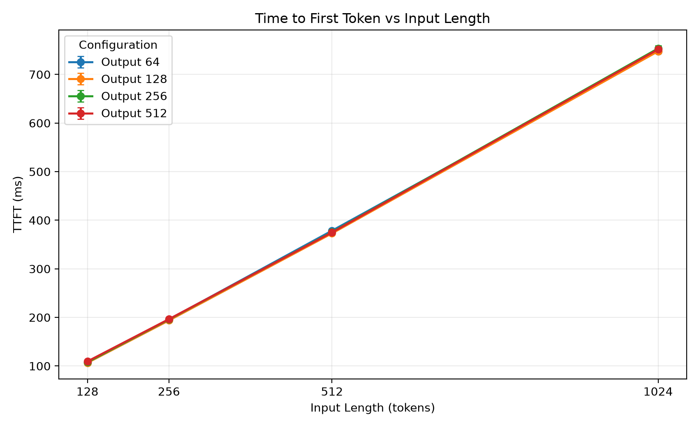
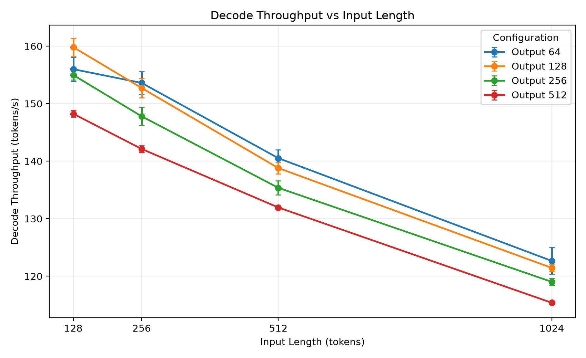
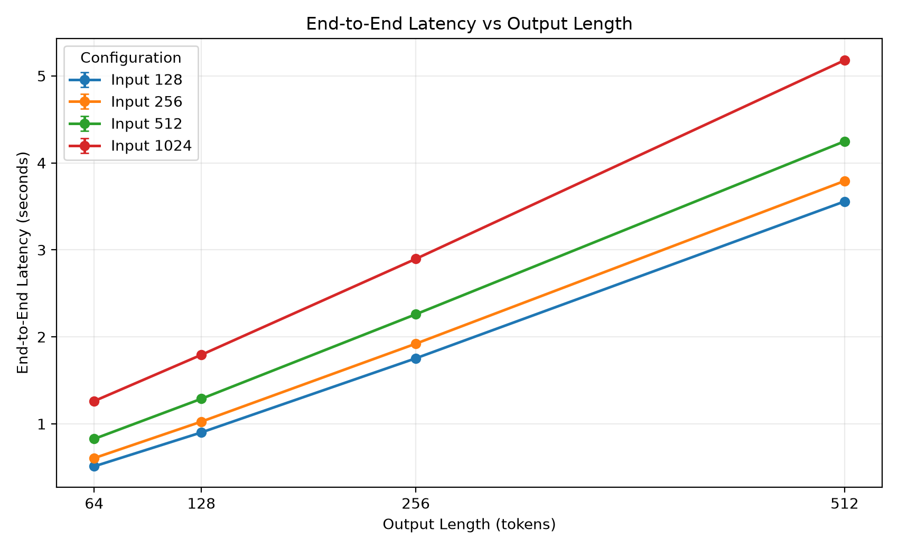
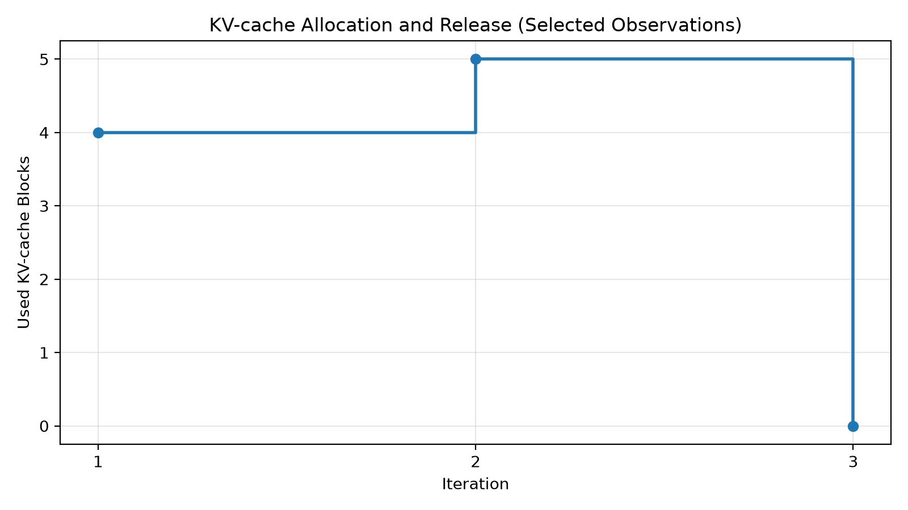

# LLM Inference Benchmark & KV-Cache Visualizer

A Python project for benchmarking large language model (LLM) inference performance and visualizing KV-cache usage.

This project builds on my summer research experience at Shanghai Jiao Tong University, where I explored LLM inference workflows, scheduling, and KV-cache management using nano-vLLM.

The repository contains two components:

- **Inference Benchmark:** Measures inference performance using Qwen3-0.6B with MLX-LM on Apple Silicon.
- **KV-Cache Visualizer:** Parses selected nano-vLLM execution logs and visualizes KV-cache block usage.

## 1. Features

**Inference Benchmark**
- Configurable input and maximum output token lengths
- Input/output length matrix experiments
- Time to first token (TTFT) measured from the first streamed token
- Decode throughput measured after the first token
- Mean, p50, and p95 inter-token latency (ITL)
- Prompt processing and end-to-end latency measurement
- Inference latency and peak memory tracking
- Warm-up runs and repeated experiments
- Mean and sample standard deviation calculations
- JSON result export and performance visualization

**KV-Cache Visualizer**
- Parses scheduler-related KV-cache logs
- Extracts iteration numbers, execution phases, and allocated KV-cache blocks
- Visualizes KV-cache block allocation and release using synthetic demonstration logs

## 2. Benchmark Results

Model: `mlx-community/Qwen3-0.6B-4bit`

Framework: MLX-LM 0.32.2

Hardware: Apple MacBook Air M2

Configuration: input lengths of 128, 256, 512, and 1024 tokens crossed with maximum output lengths of 64, 128, 256, and 512 tokens. Each of the 16 configurations has one warm-up followed by three measured runs.

The table below shows the 128-output-token slice of the new benchmark matrix (mean of three measured runs).

| Input Tokens | TTFT (ms) | Decode Throughput (tokens/s) | End-to-End Latency (s) | p95 ITL (ms) |
|---|---:|---:|---:|---:|
| 128 | 106.5 | 159.82 | 0.901 | 7.30 |
| 256 | 193.7 | 152.72 | 1.025 | 7.62 |
| 512 | 372.9 | 138.80 | 1.288 | 8.17 |
| 1024 | 747.7 | 121.45 | 1.793 | 9.12 |







TTFT increased with input length and was nearly independent of the requested output length, as expected because TTFT is measured before the remaining tokens are decoded. Decode throughput also decreased as the context grew: from 159.82 tokens/s at 128 input tokens and 128 output tokens to 121.45 tokens/s at 1024 input tokens and 128 output tokens.

### Metric definitions

- **TTFT:** wall-clock time immediately before consuming the MLX-LM stream until the first token is yielded. This includes prompt processing and first-token generation.
- **Decode throughput:** `(generated tokens - 1) / (final-token time - first-token time)`. The first token is excluded so prefill/TTFT is not mixed into decode speed.
- **Inter-token latency (ITL):** wall-clock intervals between consecutive streamed tokens. The JSON output records mean, p50, and p95 ITL.
- **End-to-end latency:** wall-clock time from immediately before stream consumption until the final token is yielded.

The raw 48-run matrix is stored in `benchmarks/results/batch_benchmark_20261104_214735_852055.json`.

These results represent a small exploratory benchmark rather than a comprehensive hardware performance evaluation.

## 3. KV-Cache Visualization

The visualizer parses synthetic nano-vLLM-style scheduler logs to demonstrate KV-cache block usage.



The included `sample.log` contains three artificially generated observations at iterations 1, 2, and 3.

These records are provided solely for demonstration and do not represent actual measurements from Shanghai Jiao Tong University or a real nano-vLLM execution.

The visualization illustrates changes in allocated KV-cache blocks. It should not be interpreted as a complete execution trace.

## 4. Project Structure

```text
llm-inference-benchmark/
├── benchmarks/
│   ├── run_benchmark.py
│   ├── batch_benchmark.py
│   ├── benchmark_core.py
│   ├── plot_benchmark.py
│   └── results/
│       ├── batch_benchmark_20261104_001244_525605.json
│       ├── batch_benchmark_20261104_214735_852055.json
│       ├── ttft_by_input.png
│       ├── decode_throughput.png
│       └── latency_by_output.png
├── visualizer/
│   ├── parse_logs.py
│   ├── plot_cache.py
│   ├── sample.log
│   └── kv_cache_observations.png
├── requirements.txt
└── README.md
```

## 5. Installation

The inference benchmark uses MLX-LM and requires a compatible Apple Silicon Mac.

Python 3.11 was used for development.

```bash
git clone https://github.com/tongdu221/llm-inference-benchmark.git
cd llm-inference-benchmark

python -m venv .venv
source .venv/bin/activate

pip install -r requirements.txt
```

The model weights will be downloaded from Hugging Face on first use.

## 6. Usage

### Single inference benchmark

```bash
python benchmarks/run_benchmark.py --input-len 256 --output-len 128
```

The script measures inference performance and saves the results as JSON.

### Repeated benchmark

```bash
python benchmarks/batch_benchmark.py
```

Runs four input-length configurations (128, 256, 512, and 1024 tokens), with one warm-up and three measured runs per configuration.

By default it crosses those inputs with output lengths of 64, 128, 256, and 512 tokens. The matrix and repetition counts are configurable:

```bash
python benchmarks/batch_benchmark.py \
  --input-lengths 128 256 512 1024 \
  --output-lengths 64 128 256 512 \
  --warmups 1 --repeats 3
```

### Generate benchmark visualization

```bash
python benchmarks/plot_benchmark.py
```

The plotting script automatically selects the newest result containing TTFT/decode fields, or accepts an explicit file through `--input`. It generates the three charts shown above without opening an interactive window.

### Generate KV-cache visualization

```bash
python visualizer/plot_cache.py
```

## 7. Research Background

During my summer research at Shanghai Jiao Tong University, I worked with nano-vLLM v0.2.0 and Qwen3-0.6B on an NVIDIA A800 80GB GPU.

My research tasks included:

- Investigating the request lifecycle and scheduling process in nano-vLLM
- Examining prefill and decode execution
- Instrumenting scheduler-related code to observe request states and KV-cache block usage
- Exploring inference performance under different input and output lengths

The KV-cache visualizer is inspired by my earlier research, but the included sample logs are synthetic and do not contain original laboratory measurements.

The benchmark scripts in this repository are a separate implementation using MLX-LM on Apple Silicon. Their performance results should not be directly compared with the earlier NVIDIA A800 experiments because the hardware, inference framework, and model precision differ.

## 8. Limitations

- Benchmarks use a 4-bit quantized model rather than the original full-precision model.
- Input prompts are constructed from repeated tokens rather than representative natural-language workloads.
- Each configuration currently has only three measured runs.
- Warm-up is performed once per input/output-length configuration.
- Tests are executed in a fixed order, without controlling thermal conditions or other system activity.
- The KV-cache visualization uses synthetic demonstration data rather than actual scheduler measurements.

## 9. Future Improvements

- Add representative natural-language and coding prompt sets
- Randomize configuration order and record thermal/power metadata
- Extend benchmarking to multiple concurrent requests
- Improve KV-cache visualization using complete scheduler logs
- Add more detailed experiment metadata and reproducibility checks
