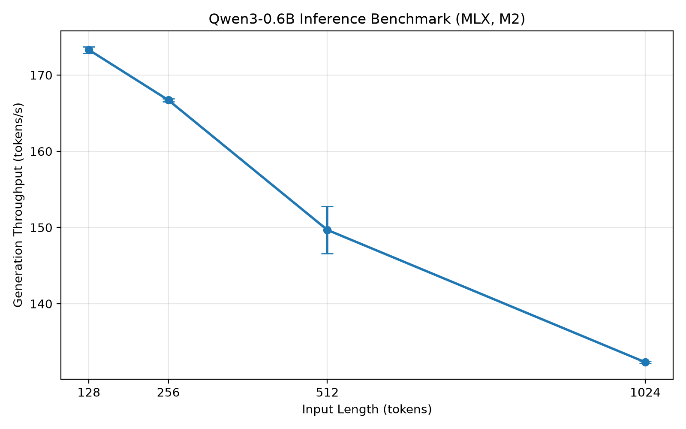

# LLM Inference Benchmark & KV-Cache Visualizer

A Python project for benchmarking large language model (LLM) inference performance and visualizing KV-cache usage.

This project builds on my summer research experience at Shanghai Jiao Tong University, where I explored LLM inference workflows, scheduling, and KV-cache management using nano-vLLM.

The repository contains two components:

- **Inference Benchmark:** Measures inference performance using Qwen3-0.6B with MLX-LM on Apple Silicon.
- **KV-Cache Visualizer:** Parses selected nano-vLLM execution logs and visualizes KV-cache block usage.

## 1. Features

**Inference Benchmark**
- Configurable input and maximum output token lengths
- Prompt processing and generation throughput measurement
- Inference latency and peak memory tracking
- Warm-up runs and repeated experiments
- Mean and sample standard deviation calculations
- JSON result export and performance visualization

**KV-Cache Visualizer**
- Parses scheduler-related KV-cache logs
- Extracts iteration numbers, execution phases, and allocated KV-cache blocks
- Visualizes KV-cache block allocation and release using synthetic demonstration logs

## 2. Benchmark Results

Model: `mlx-community/Qwen3-0.6B-4bit`

Framework: MLX-LM 0.32.2

Hardware: Apple MacBook Air M2

Configuration: 128 maximum output tokens, three measured runs per input length, with one warm-up run per configuration.

| Input Tokens | Mean Generation Throughput (tokens/s) | Std (tokens/s) |
|---|---:|---:|
| 128 | 173.30 | 0.41 |
| 256 | 166.71 | 0.19 |
| 512 | 149.68 | 3.09 |
| 1024 | 132.31 | 0.15 |



In these experiments, average generation throughput decreased as input length increased. From 128 to 1024 input tokens, generation throughput decreased by approximately 23.7%.

These results represent a small exploratory benchmark rather than a comprehensive hardware performance evaluation.

## 3. KV-Cache Visualization

The visualizer parses synthetic nano-vLLM-style scheduler logs to demonstrate KV-cache block usage.


The included `sample.log` contains three artificially generated observations at iterations 1, 2, and 3.

These records are provided solely for demonstration and do not represent actual measurements from Shanghai Jiao Tong University or a real nano-vLLM execution.

The visualization illustrates changes in allocated KV-cache blocks. It should not be interpreted as a complete execution trace.

## 4. Project Structure

```text
llm-inference-benchmark/
├── benchmarks/
│   ├── run_benchmark.py
│   ├── batch_benchmark.py
│   ├── plot_benchmark.py
│   └── results/
│       ├── batch_benchmark_20261104_001244_525605.json
│       └── generation_throughput.png
├── visualizer/
│   ├── parse_logs.py
│   ├── plot_cache.py
│   ├── sample.log
│   └── kv_cache_observations.png
├── requirements.txt
└── README.md
```

## 5. Installation

The inference benchmark uses MLX-LM and requires a compatible Apple Silicon Mac.

Python 3.11 was used for development.

```bash
git clone https://github.com/tongdu221/llm-inference-benchmark.git
cd llm-inference-benchmark

python -m venv .venv
source .venv/bin/activate

pip install -r requirements.txt
```

The model weights will be downloaded from Hugging Face on first use.

## 6. Usage

### Single inference benchmark

```bash
python benchmarks/run_benchmark.py --input-len 256 --output-len 128
```

The script measures inference performance and saves the results as JSON.

### Repeated benchmark

```bash
python benchmarks/batch_benchmark.py
```

Runs four input-length configurations (128, 256, 512, and 1024 tokens), with one warm-up and three measured runs per configuration.

### Generate benchmark visualization

```bash
python benchmarks/plot_benchmark.py
```

### Generate KV-cache visualization

```bash
python visualizer/plot_cache.py
```

## 7. Research Background

During my summer research at Shanghai Jiao Tong University, I worked with nano-vLLM v0.2.0 and Qwen3-0.6B on an NVIDIA A800 80GB GPU.

My research tasks included:

- Investigating the request lifecycle and scheduling process in nano-vLLM
- Examining prefill and decode execution
- Instrumenting scheduler-related code to observe request states and KV-cache block usage
- Exploring inference performance under different input and output lengths

The KV-cache visualizer is inspired by my earlier research, but the included sample logs are synthetic and do not contain original laboratory measurements.

The benchmark scripts in this repository are a separate implementation using MLX-LM on Apple Silicon. Their performance results should not be directly compared with the earlier NVIDIA A800 experiments because the hardware, inference framework, and model precision differ.

## 8. Limitations

- Benchmarks use a 4-bit quantized model rather than the original full-precision model.
- Input prompts are constructed from repeated tokens rather than representative natural-language workloads.
- Each configuration currently has only three measured runs.
- Warm-up is performed once per input-length configuration.
- Tests are executed in a fixed order, without controlling thermal conditions or other system activity.
- The KV-cache visualization uses synthetic demonstration data rather than actual scheduler measurements.

## 9. Future Improvements

- Support additional models and input/output configurations
- Add configurable repetition counts and warm-up settings
- Measure time to first token (TTFT) and decode latency separately
- Extend benchmarking to multiple concurrent requests
- Improve KV-cache visualization using complete scheduler logs
- Add more detailed experiment metadata and reproducibility checks